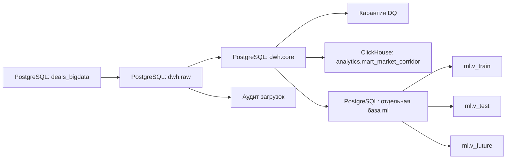

# Smart Logistics: DWH, аналитические витрины и данные для ML

Учебный проект обработки данных о тарифах грузоперевозок.

Реализованы:

- загрузка исходных данных в RAW;

- подготовка CORE с проверками качества и обогащением;

- рыночная витрина в ClickHouse;

- отдельное хранилище ML-датасетов в PostgreSQL;

- оркестрация через Apache Airflow.

Обучение моделей и прогнозирование не входят в реализованный объём.

## Архитектура



Стек:

- PostgreSQL 17;

- Apache Airflow 3.1.7;

- ClickHouse;

- Python, psycopg2 и SQL;

- Docker Compose.

Дата среза задания — **2026-10-26**, независимо от системной даты запуска.

## Структура проекта

```text
dags/               DAG Airflow и загрузчик RAW
etl/core/           Преобразования RAW → CORE
etl/mart/           Подготовка рыночной витрины
etl/ml/             Подготовка ML-датасетов
sql/                Схемы, генерация данных, проверки и обслуживание
docker/             Первичная инициализация баз
attachments/        Материалы задания
docker-compose.yml  Конфигурация сервисов
airflow.env.example Пример настроек окружения
```

Личные настройки находятся в `airflow.env`, который исключён из Git.

## Запуск с нуля

Требуются Git, Docker и Docker Compose **2.24.0 или новее**.
Docker должен иметь достаточно памяти и места для PostgreSQL, ClickHouse
и трёх процессов Airflow. Первый запуск скачивает образы и генерирует данные.

Команды для PowerShell:

```powershell
git clone https://github.com/SukhorukovD/DE_Vacancies_Smart_Logistic.git
cd DE_Vacancies_Smart_Logistic
docker compose up -d
```

По умолчанию используются настройки локального демо из `airflow.env.example`.
Копировать его не требуется. Необязательный `airflow.env` переопределяет настройки
и исключён из Git. Порты баз и UI опубликованы только на localhost.

Airflow UI: http://localhost:8080. Пользователь: `admin`.
После запуска API-сервера посмотреть сгенерированный пароль:

```powershell
docker compose exec -T airflow-api-server cat /opt/airflow/state/simple_auth_manager_passwords.json
```

Пароль хранится в отдельном Docker volume и сохраняется при перезапуске.
Настройки входа можно переопределить в `airflow.env`.

### Что выполняется автоматически

1. PostgreSQL становится доступен.
2. Сервис `db-bootstrap` создаёт отсутствующие базы `deals_bigdata`, `dwh`, `airflow`.
3. Для нового источника в одной транзакции выполняются `sql/schema.sql`
   и `sql/synthetic.sql`: по умолчанию генерируются 300 000 сделок.
4. В DWH последовательно выполняются `core_model.sql`, `001_prepare_core.sql`,
   `004_task_pipeline.sql`. Таблицы RAW создаются по каталогу источника.
5. `airflow-init` применяет миграции метаданных, затем стартуют компоненты Airflow.

База `ml` и таблицы MART создаются соответствующими DAG при первом запуске.
Сами DAG запускаются вручную в порядке, указанном ниже.

Повторная инициализация сохраняет исходные данные и результаты ETL.
Скрипты сброса и восстановления автоматически **не запускаются**.
При обнаружении старой несовместимой схемы CORE инициализация завершается
с ошибкой, сохраняя данные; автоматического удаления таблиц нет.

Для быстрого знакомства можно уменьшить исходный набор **до первого запуска**:

```powershell
$env:N_PRICES = "5000"
docker compose up -d
```

Для уже заполненного источника `N_PRICES` не изменяет количество строк.
Результаты небольшого набора будут отличаться от приведённых ниже результатов
запуска на 300 000 сделок.

Проверить состояние и логи инициализации:

```powershell
docker compose ps -a
docker compose logs --tail 100 db-bootstrap airflow-init
```

Для `db-bootstrap` и `airflow-init` нормальное итоговое состояние — `Exited (0)`.
Если сервис завершился с ошибкой, сначала исправить её по логу.
Для остановки с сохранением данных: `docker compose down`.
Флаг `-v` удаляет тома с базами и для обычного перезапуска не нужен.

Проверка: на пустом PostgreSQL 17 выполнены инициализация, повторный запуск,
миграции Airflow и функции ETL на 5 000 сделок. CORE: 4 994 принятых строки,
6 отклонённых; ML: 687 строк. Все четыре DAG импортированы в Airflow 3.1.7.
SQL MART проверен через chDB (ClickHouse 26.9), опубликовано 4 711 ячеек.
Полный старт Docker-стека с пустыми томами в проверочной среде не выполнен
из-за ограничения диска; его нужно подтвердить на машине с Docker.

## Запуск пайплайнов

В Airflow включить нужный DAG и выполнить Trigger DAG без конфигурации.

Порядок:

1. `raw_ingestion` — загрузка источника в RAW.

2. `raw_to_core` — после успешного RAW.

3. `core_to_mart` — после успешного CORE.

4. `core_to_ml` — после успешного CORE.

MART и ML независимы друг от друга.

DAG запускаются вручную: `schedule=None`.

Автоматической цепочки между отдельными DAG пока нет.

## RAW и CORE

RAW сохраняет новые и изменённые версии записей и аудит загрузки.

Нулевое число новых строк в батче не означает отсутствие данных.

CORE восстанавливает снимок из успешной истории каждой исходной таблицы

до выбранного батча. Целевой батч должен содержать все 11 успешных задач RAW.

В CORE выполняются:

- проверки цены, расстояния, веса и объёма;

- проверка ссылок на справочники;

- сохранение отклонённых строк с причинами в `quarantine.invalid_records`;

- конвертация валют в RUB по точному курсу на `nearest_rate_date`;

- заполнение весовой и объёмной категорий;

- дедупликация городов;

- унификация групп кузова;

- сохранение истории версий цен и курсов.

Текущие версии имеют `is_current=true`.

Пустой снимок цен останавливает подготовку CORE.

Совпадение городов отправления и назначения само по себе

не является причиной отбраковки.

## Рыночная витрина

Таблица ClickHouse:

```text
analytics.mart_market_corridor
```

Детализация:

```text
месяц × город отправления × город назначения × группа кузова × весовая категория
```

Месяц определяется по `price_dates`, а не по дате погрузки.

Включаются факты типов `1,2,3,4,5,9`, простые маршруты и строки

без флага выброса. Даты после среза исключаются до группировки.

Несколько дат одной сделки внутри месяца не удваивают её вклад

в одну группу кузова.

Рассчитываются:

- P25, P50, P75 и средняя цена за рейс;

- P25, P50, P75 за километр;

- число рейсов и уникальных перевозчиков;

- выборочный коэффициент вариации;

- календарные MoM и YoY;

- уровень надёжности.

Перевозчики считаются по уникальному `organization_id`

только для типов `3` и `9`.

Используются точные интерполированные квартили.

При отсутствии календарного периода сравнения MoM/YoY возвращают NULL.

Надёжность:

- HIGH: не менее 30 рейсов, 5 перевозчиков и свежесть последней

  вошедшей в ячейку даты не более 30 дней относительно среза;

- MEDIUM: не менее 10 рейсов;

- LOW_DATA: остальные случаи.

Загрузка выполняется пакетами по 25 000 строк.

После проверок новая витрина публикуется атомарным `EXCHANGE TABLES`.

До публикации доступна предыдущая версия.

## Хранилище ML-данных

Отдельная база PostgreSQL `ml` создаётся задачей `prepare`.

Основные объекты:

| Объект | Назначение |
|---|---|
| `ml.datasets` | Версии датасетов, параметры, происхождение и проверки |
| `ml.features` | Признаки и служебные идентификаторы |
| `ml.targets` | Историческая целевая цена |
| `ml.current_dataset` | Ссылка на опубликованную версию |
| `ml.v_train` | Обучающая выборка текущей версии |
| `ml.v_test` | Тестовая выборка текущей версии |
| `ml.v_future` | Будущие заявки текущей версии |

Одна сделка представлена одной строкой.

Несколько групп кузова кодируются отдельными флагами.

Подготовлены 29 модельных признаков:

- города и регионы отправления/назначения;

- географические координаты;

- расстояние, вес и объём;

- категории груза;

- группы кузова;

- календарные признаки и sin/cos.

Список допустимых входов модели задан в `FEATURE_COLUMNS`.

Служебные идентификаторы и целевая цена в него не входят.

### Временное разделение

| Набор | Дата погрузки | Целевая цена |
|---|---|---|
| train | 2026-07-26 ≤ дата < 2026-10-05 | Заполнена |
| test | 2026-10-05 ≤ дата ≤ 2026-10-26 | Заполнена |
| future | дата > 2026-10-26 | NULL |

История отбирается по фактам, простым маршрутам и отсутствию флага выброса.

Для будущих простых заявок цена маскируется ещё при выгрузке из CORE.

Флаг выброса для отбора будущих заявок не используется.

Тарифы, производные от цены, маржа, `price_group_stats`,

агрегаты MART и `outlier_mark` в признаки не включаются.

### Загрузка и публикация

Передача между базами выполняется через COPY.

Преобразования выполняются SQL.

Публикация переключает текущую версию в транзакции.

Повторная попытка задачи не удваивает строки версии.

Новый DAG run создаёт отдельную версию датасета.

Предыдущие версии сохраняются; представления показывают только текущую.

## Результаты проверенного запуска

Исходный набор — 300 000 сделок.

| Показатель | Значение |
|---|---:|
| Принято в текущий CORE | 299 797 |
| Отклонено по DQ | 203 |
| Ячеек MART | 203 644 |
| Рейсов по ячейкам MART | 291 020 |
| Ячеек HIGH | 10 |
| Ячеек MEDIUM | 924 |
| Ячеек LOW_DATA | 202 710 |
| ML train | 24 226 |
| ML test | 12 808 |
| ML future | 5 820 |
| Всего строк текущего ML-датасета | 42 854 |

У всех текущих CORE-цен заполнен положительный `price_rub`.

Проверки ML показали:

- 0 дублей сделок;

- 0 нарушений временного разделения;

- 0 будущих целевых цен;

- 0 невалидных исторических целей;

- 0 пропусков координат и регионов.

Количество рейсов по ячейкам MART не равно числу сделок CORE:

применяются фильтры, а сделка может входить в несколько месяцев и групп кузова.

## Проверки после запуска

CORE:

```powershell
docker compose exec -T postgres psql -U postgres -d dwh -c "SELECT count(*) AS current_prices,count(*) FILTER (WHERE price_rub>0) AS with_price_rub FROM core.prices WHERE is_current;"
```

MART:

```powershell
docker compose exec -T clickhouse clickhouse-client --query "SELECT count() AS cells,sum(trips_count) AS trips_in_cells FROM analytics.mart_market_corridor FORMAT Vertical"
```

ML:

```powershell
docker compose exec -T postgres psql -U postgres -d ml -c "SELECT split,count(*) AS rows,min(loading_date),max(loading_date),count(target_price_rub) AS targets FROM ml.v_dataset GROUP BY split ORDER BY split;"
```

Для train/test число целей должно совпадать с числом строк.

Для future число целей должно быть равно нулю.

## Ограничения

- Большинство ячеек MART имеют LOW_DATA. Ставки нужно интерпретировать

  вместе с количеством наблюдений.

- Флаг выброса берётся из источника. Последний день снимка мог ещё

  не пройти ночную разметку.

- Будущие ML-заявки берутся из прошедшего CORE. Отброшенные ранее заявки

  без корректной цены или курса не восстанавливаются.

- Разделение ML выполнено по дате погрузки. Историческое состояние

  справочников на дату среза отдельно не восстанавливается.

- Обучение моделей, настройка преобразований и batch-прогнозы не выполнялись.

- Автоматическое удаление старых версий ML-датасетов пока не предусмотрено.
